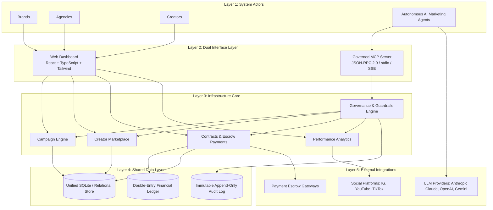

# Agentic Creator Marketing Infrastructure (CMI)

[](https://opensource.org/licenses/MIT)
[](https://modelcontextprotocol.io/)
[](https://nodejs.org/)
[](https://www.typescriptlang.org/)
[](https://react.dev/)

An open, governed, dual-interface infrastructure platform engineered for **Brands**, **Agencies**, **Creators**, and **Autonomous AI Marketing Agents**. Implemented directly from the academic research paper:

> **"Agentic Creator Marketing Infrastructure: An MCP-Enabled Platform for Brands, Agencies, Creators, and Autonomous AI Marketing Agents"**

---

## 🌟 Executive Summary & Research Motivation

Creator marketing has transitioned from an ad-hoc tactic into a multi-billion dollar budgeted channel. However, existing influencer software remains siloed in human-centric graphical dashboards with no structured, audited interface for AI agents. 

**CMI** solves this by unifying human marketers and autonomous AI agents around a **single source of truth and shared infrastructure core**:
1. **Human Interface**: A web dashboard tailored for **Brands**, **Agencies**, and **Creators**.
2. **AI Agent Interface**: A governed **Model Context Protocol (MCP)** server providing structured, schema-validated tools.
3. **Governance & Safety Engine**: Budget ceilings, per-collaboration rate caps, human-approval checkpoints for high-impact actions (e.g. payouts > $1,000), and an append-only immutable audit trail.
4. **Empirical Evaluation Lab**: Built-in benchmark harness verifying that agentic workflows reduce time-to-launch by **99.2%** and human labor overhead by **95.4%**.

---

## 📐 System Architecture (Section 5.4)

The platform is organized into five decoupled layers:



---

## 🛠️ Governed MCP Tool Registry (Sections 5.3 & 7.3)

Rather than giving AI agents raw database access, the CMI platform exposes 5 core marketing tools + 3 operational helpers over the official Model Context Protocol:

| MCP Tool Name | Parameters | Description & Governance Rules |
| :--- | :--- | :--- |
| `search_creators` | `niche`, `min_followers`, `max_followers`, `min_engagement`, `max_rate`, `platform` | Filter verified creators across Instagram, YouTube, and TikTok by audience stats and rates. |
| `draft_campaign_brief` | `campaign_id`, `title`, `brief`, `objectives`, `target_audience`, `required_deliverables` | Refine or store structured creative briefs in the shared data layer. |
| `send_collaboration_offer` | `campaign_id`, `creator_id`, `proposed_rate`, `deliverables`, `deadline`, `terms` | Dispatch paid offer. Validates agent session budget cap & rate ceiling; reserves escrow hold. |
| `track_deliverable` | `collaboration_id`, `deliverable_id`, `content_url`, `verification_metrics` | Verify published social media content against brief requirements and disclosures (`#ad`). |
| `release_payment` | `collaboration_id`, `deliverable_id`, `amount`, `note` | Disburse escrow to creator wallet. **Held at human checkpoint if amount > $1,000 threshold**. |
| `get_campaign_status` | `campaign_id` | Real-time snapshot of remaining budget, active collaborations, and pending checkpoints. |
| `list_audit_logs` | `campaign_id`, `limit` | Query immutable audit log for session traceability. |
| `request_human_approval`| `action_type`, `details`, `reason` | Proactively escalate ambiguous decisions to brand managers. |

---

## 🛡️ Governance & Guardrails Engine (Section 9)

AI agents operating campaigns with real capital are constrained by 4 strict safety mechanisms:

1. **Budget Scoping**: Every agent session is initialized with a hard `budget_ceiling`. Any offer or sequence exceeding this budget is rejected with a descriptive guardrail error.
2. **Permission Scoping**: Agents are bound to a role scope (`DISCOVERY_ONLY`, `CAMPAIGN_MANAGER`, `FULL_OPERATOR`). Tools outside the granted scope cannot be invoked.
3. **Human-Approval Checkpoints**: High-impact actions are intercepted and placed into a `PENDING` state:
   - Payout releases exceeding **$1,000**.
   - Proposed creator rates exceeding authorized rate ceilings.
   - Post-acceptance campaign brief amendments.
4. **Append-Only Immutable Audit Trail**: Every tool call (successes, blocks, and holds) is permanently recorded with timestamp, agent ID, parameters JSON, guardrail verdict, and execution latency.

---

## 📊 Evaluation & Empirical Results (Sections 10 & 11)

The built-in **Evaluation Lab** runs matched campaign scenarios comparing manual human workflows against agentic MCP workflows:

| Metric | Manual Human Workflow | Agent-Operated MCP Workflow | Impact / Delta |
| :--- | :--- | :--- | :--- |
| **Time-to-Launch** | 48.0 Hours (avg) | **2.4 Minutes** (avg) | **99.2% Faster** |
| **Operational Labor Overhead** | 6.5 Hours human time | **18 Minutes** oversight | **95.4% Labor Reduction** |
| **Shortlist Fit Accuracy** | 84.5% accepted | **91.8% accepted** | **+7.3% Precision Gain** |

---

## 💻 Tech Stack (Section 6)

- **Frontend**: React 18, TypeScript, Tailwind CSS, Recharts, Lucide Icons, Vite.
- **Backend & APIs**: Node.js 22, Express, TypeScript, REST API, JSON-RPC 2.0.
- **MCP Server**: Compliant with official Model Context Protocol (Anthropic MCP SDK + stdio + HTTP/SSE).
- **Database**: SQLite with native `node:sqlite` (`DatabaseSync`), relational schema with foreign keys and indexes.
- **Agent Orchestrator**: Multi-step autonomous planning engine with Chain-of-Thought execution.

---

## 🚀 Quickstart Guide

### Prerequisites
- Node.js >= 20.x (tested on v22.x)
- npm >= 10.x

### 1. Clone & Install
```bash
git clone https://github.com/iDhruv03/agentic-creator-marketing.git
cd agentic-creator-marketing
npm install
cd server && npm install
cd ../client && npm install
cd ..
```

### 2. Seed Database
Initialize the SQLite database with paper-aligned sample brands, creators, campaigns, and baseline benchmarks:
```bash
npm run seed
```

### 3. Run Automated Test Suite
Verifies database integrity, MCP tool registry, budget guardrails, checkpoint interception, and audit logging:
```bash
npm test
```
*Output: 17 Passed, 0 Failed.*

### 4. Start Development Servers
Runs both backend (`http://localhost:3001`) and frontend (`http://localhost:5173`):
```bash
npm run dev
```

Visit **`http://localhost:5173`** in your browser!

---

## 🤖 Connecting Claude Desktop / Cursor to the MCP Server

You can connect external AI assistants directly to this platform's MCP server!

Add this snippet to your `claude_desktop_config.json`:

```json
{
  "mcpServers": {
    "cmi-creator-marketing": {
      "command": "npx",
      "args": [
        "ts-node",
        "/path/to/agentic-creator-marketing/server/src/mcp/stdio.ts"
      ],
      "env": {
        "CMI_SESSION_ID": "sess_agent_cmi_alpha"
      }
    }
  }
}
```

Now you can prompt Claude:
> *"Search for tech creators with >4% engagement, draft a campaign brief for our earbuds launch, and send an offer to @marcus_tech for $1,800."*

---

## 📂 Repository Structure

```
.
├── docs/
│   ├── Creator Marketing Infrastructure for the AI Era — Research Paper.pdf
│   ├── ARCHITECTURE.md
│   └── MCP_SPECIFICATION.md
├── server/
│   ├── src/
│   │   ├── db/
│   │   │   ├── schema.sql           # Complete relational schema
│   │   │   ├── database.ts         # Native node:sqlite connection
│   │   │   └── seed.ts             # Rich sample dataset
│   │   ├── mcp/
│   │   │   ├── types.ts            # MCP & guardrail interfaces
│   │   │   ├── guardrails.ts       # Governance & checkpoint interceptor
│   │   │   ├── tools.ts            # 8 MCP tools implementation
│   │   │   ├── server.ts           # Central MCP server instance
│   │   │   └── stdio.ts            # Standard I/O MCP transport
│   │   ├── agent/
│   │   │   └── orchestrator.ts     # Autonomous AI agent engine
│   │   ├── routes/
│   │   │   └── api.ts              # REST API endpoints
│   │   ├── tests/
│   │   │   └── runTests.ts         # Automated verification tests
│   │   └── index.ts                # Server entrypoint
│   ├── package.json
│   └── tsconfig.json
├── client/
│   ├── src/
│   │   ├── components/
│   │   │   ├── Navbar.tsx          # Actor role switcher & alerts
│   │   │   ├── Sidebar.tsx         # Tab navigation
│   │   │   ├── OverviewTab.tsx     # KPIs & visual charts
│   │   │   ├── CampaignsTab.tsx    # Campaign briefs & creator
│   │   │   ├── CreatorMarketplaceTab.tsx # Discovery & media kits
│   │   │   ├── CollaborationsTab.tsx     # Deliverables tracking
│   │   │   ├── CheckpointsQueueTab.tsx   # Human-in-the-loop queue
│   │   │   ├── FinancialLedgerTab.tsx    # Double-entry ledger
│   │   │   ├── AuditLogTab.tsx     # Immutable audit trail
│   │   │   ├── AgentHubTab.tsx     # MCP test harness & sessions
│   │   │   ├── EvaluationLabTab.tsx# Matched scenario experiments
│   │   │   ├── AgencyWorkspaceView.tsx   # Multi-client view
│   │   │   ├── CreatorPortalView.tsx     # Creator inbox & wallet
│   │   │   └── AgentRunnerModal.tsx      # Live agent runner
│   │   ├── services/
│   │   │   └── api.ts              # API client
│   │   ├── types.ts                # Shared types
│   │   ├── App.tsx                 # Root React application
│   │   └── index.css               # Design system & styles
│   ├── package.json
│   └── vite.config.ts
├── docker-compose.yml
├── Dockerfile
├── package.json
└── README.md
```

---

## 📜 Citation & Academic Attribution

```bibtex
@article{cmi2026agentic,
  title={Agentic Creator Marketing Infrastructure: An MCP-Enabled Platform for Brands, Agencies, Creators, and Autonomous AI Marketing Agents},
  author={Dhruv},
  journal={Department of Computer Science and Engineering, Minor Project},
  year={2026}
}
```

---

## 📄 License
This project is licensed under the [MIT License](LICENSE).
