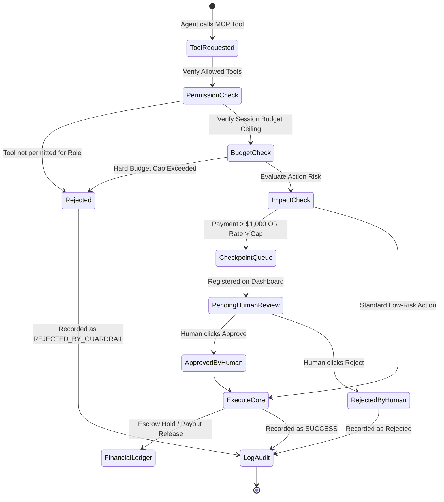

# System Architecture Document

## Overview

The **Creator Marketing Infrastructure (CMI)** platform bridges human actors (Brands, Agencies, Creators) and Autonomous AI Marketing Agents using a **dual-interface architecture** backed by a shared business-logic core and a single source of truth data layer.

---

## 1. Five-Layer Architecture Decomposition

```
[Layer 1: Actors]
  ├── Brands
  ├── Agencies (Multi-Client Segregation)
  ├── Creators
  └── Autonomous AI Marketing Agents

[Layer 2: Dual Interface Layer]
  ├── Web / App GUI (React + TypeScript + Tailwind)
  └── Governed Model Context Protocol (MCP) Server (JSON-RPC 2.0 / stdio / SSE)

[Layer 3: Infrastructure Core & Governance Engine]
  ├── Campaign Engine (Lifecycle, Briefs, Scopes)
  ├── Creator Marketplace (Discovery, Demographics, Media Kits)
  ├── Contracts & Escrow Payments (Agreements, Holds, Payouts)
  ├── Governance & Guardrails Engine (Budget Caps, Rate Checks, Checkpoints)
  └── Evaluation Engine (Matched Empirical Comparisons)

[Layer 4: Shared Data Layer]
  ├── Creator Profiles & Rate Cards
  ├── Campaigns & Required Deliverables
  ├── Collaborations & Content Submissions
  ├── Double-Entry Financial Ledger
  ├── Append-Only Immutable Audit Trail
  └── Human-Approval Checkpoint Queue

[Layer 5: External Integrations]
  ├── Social Platform APIs (Instagram, YouTube, TikTok)
  ├── Escrow Payment Processors
  └── Foundation LLMs (Claude, OpenAI, Gemini)
```

---

## 2. Core Record Types (Section 5.5)

The shared data model is anchored around four interconnected record types:

1. **Creator Profiles**:
   - Identity, social handles, verified status, rating.
   - Primary and secondary niches.
   - Cross-platform statistics (followers, engagement rate).
   - Structured rate cards (video, reel, post, story).
   - Audience demographics (top country, age, gender split).
   - Real-time wallet balance and escrow pending.

2. **Campaigns**:
   - Brand and agency references.
   - Creative brief, objectives, target audience, and guidelines.
   - Required deliverables list.
   - Total budget, spent budget, and escrow locked.
   - Lifecycle state (`DRAFT`, `ACTIVE`, `PAUSED`, `COMPLETED`).

3. **Collaborations**:
   - Links campaign and creator.
   - Initiator attribution (`HUMAN` vs `AGENT`).
   - Proposed vs agreed rate.
   - Digital agreement terms and deadline.
   - Associated deliverables with live submission links and engagement metrics.
   - Collaboration state machine:
     `OFFERED` &rarr; `ACCEPTED` &rarr; `IN_PROGRESS` &rarr; `DELIVERABLE_SUBMITTED` &rarr; `APPROVED` &rarr; `COMPLETED`.

4. **Ledger Entries**:
   - Append-only financial transactions.
   - Entry types: `BUDGET_ALLOCATION`, `ESCROW_HOLD`, `PAYOUT_RELEASE`, `REFUND`.
   - Explicit attribution to actor type (`HUMAN` vs `AGENT`) and actor ID.
   - Running post-transaction balance calculation.

---

## 3. Governance Engine & State Machine


